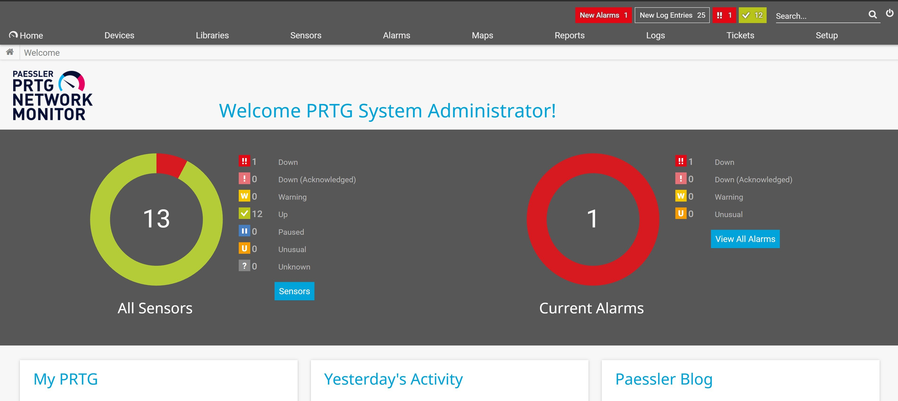

# Enterprise NOC Incident Management & Telemetry Monitoring Lab

## Executive Summary
This project simulates the end-to-end operational lifecycle of a critical enterprise network failure within a Tier-1/Tier-2 Network Operations Center (NOC) environment. The scenario bridges real-time infrastructure telemetry and threshold-based alerting via **Paessler PRTG Network Monitor** with enterprise IT Service Management (ITSM) operational triage, escalation, and SLA management within **ServiceNow**.

---

## Technical Stack & Tooling
* **Network Monitoring System (NMS):** Paessler PRTG Network Monitor (Local Probe Architecture)
* **ITSM & Ticket Management:** ServiceNow Enterprise Incident Management (`Incident` Application)
* **Monitored Protocols & Services:** ICMP (Ping v2), DNS (Port 53), HTTP/HTTPS (Port 80/443), Performance Counters / WMI
* **Target Infrastructure:** Distribution Switch (`SW-DIST-01`), Default Gateway/DNS Server (`SAX1V1S`), Internet Edge

---

## Network Topology & Monitoring Hierarchy

The monitoring architecture was structured hierarchically to isolate failures between perimeter connectivity, internal routing/switching layers, and host-level services.

### Monitored Endpoints & Baseline Telemetry
* **Internet Edge:** Verified HTTP availability and latency (121 ms) to ensure upstream transit provider stability.
* **Core Gateway (`SAX1V1S`):** Monitored via multi-sensor probes including sub-millisecond ICMP Ping, DNS resolution verification, SSL security negotiation, and HTTPS health (11 ms).
* **Distribution Layer (`SW-DIST-01`):** Integrated via ICMP reachability checks to simulate switch availability across access boundaries.
* **Probe Core & Host Health:** Monitored local system parameters (CPU load, memory allocation, and performance counters at nominal levels).

---

## Incident Lifecycle: Critical Outage Simulation

### Phase 1: Real-Time Telemetry Detection & Alert Trigger
* **Timestamp:** 08:12:00 EST
* **Event:** The local PRTG probe failed to receive ICMP echo responses from distribution switch `SW-DIST-01` (`192.168.1.240`).
* **NMS Behavior:** Following a transient grace interval, the sensor escalated into a hard `Down` state, triggering immediate visual alarms across the NOC console (`13 Total Sensors: 1 Down, 12 Up, 1 Active Alarm`).

---

### Phase 2: ITSM Intake & Tier-2 Triage (ServiceNow INC0010004)
Upon alert generation, Incident Ticket **`INC0010004`** was initiated to coordinate troubleshooting, containment, and SLA tracking:

* **Configuration Item (CI):** `SW-DIST-01` (Core Distribution Switch)
* **Impact / Urgency:** 1 - High / 1 - High (**Priority 1 - Critical**)
* **Assignment Group:** Network Operations Center (NOC Tier 2)

#### Diagnostic Runbook Execution:
1. **OSI Layer 1 (Physical Layer):** Verified power and operational state on core gateway (`SAX1V1S`); interface links remained active, ruling out facility-wide power loss.
2. **OSI Layer 2 (Data Link Layer):** Queried ARP tables and switch trunk allocations; identified loss of MAC address advertisement across primary distribution port channels.
3. **OSI Layer 3 (Network Layer):** Executed ICMP pings and traceroutes; confirmed 100% packet loss isolated specifically to the `SW-DIST-01` management interface.

---

### Phase 3: Escalation & Remediation Coordination
* Ruled out route flapping on adjacent edge equipment.
* Documented diagnostic work notes and escalated circuit telemetry logs to Tier-3 Infrastructure Engineering and third-party transport carriers under strict P1 SLA runbooks.
* Failover routes were engaged to divert critical traffic while the distribution hardware and interface uplinks were stabilized.

---

### Phase 4: Verification & Telemetry Normalization
* Re-established physical and logical link reachability to the distribution switch.
* Telemetry confirmed ICMP latency normalized to standard operating thresholds (`<20 ms`) with 0% packet loss.
* Incident `INC0010004` was transitioned to **Resolved** with documented root-cause findings and resolution notes.
* PRTG Network Monitor returned to an all-green baseline state (`13 Total Sensors: 13 Up, 0 Alarms`).

---

## Key NOC Competencies Demonstrated
* **Telemetry & Threshold Configuration:** Creating network devices, configuring multi-protocol sensors (ICMP, DNS, HTTP), and analyzing real-time probe responses.
* **ITIL Incident Management:** Managing critical incident records in ServiceNow, classifying impact/urgency, and writing detailed technical work notes.
* **Systematic Fault Isolation:** Applying structured OSI Layer 1–3 troubleshooting methodologies to isolate network failures rapidly under SLA pressure.
* **Operational Documentation:** Maintaining end-to-end auditability across monitoring events, incident tickets, and post-resolution baselines.
